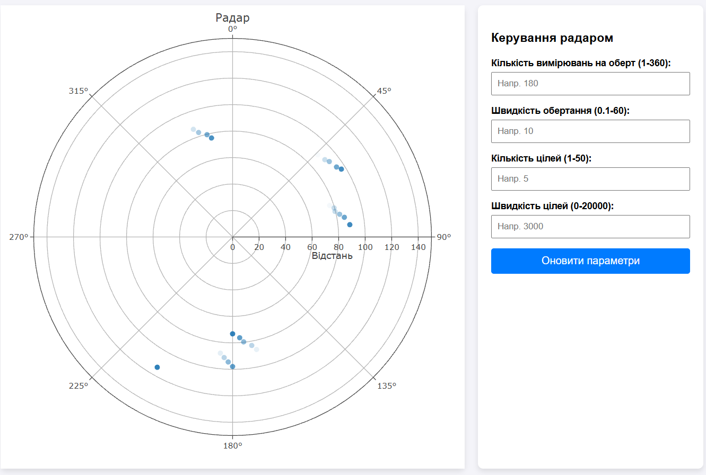
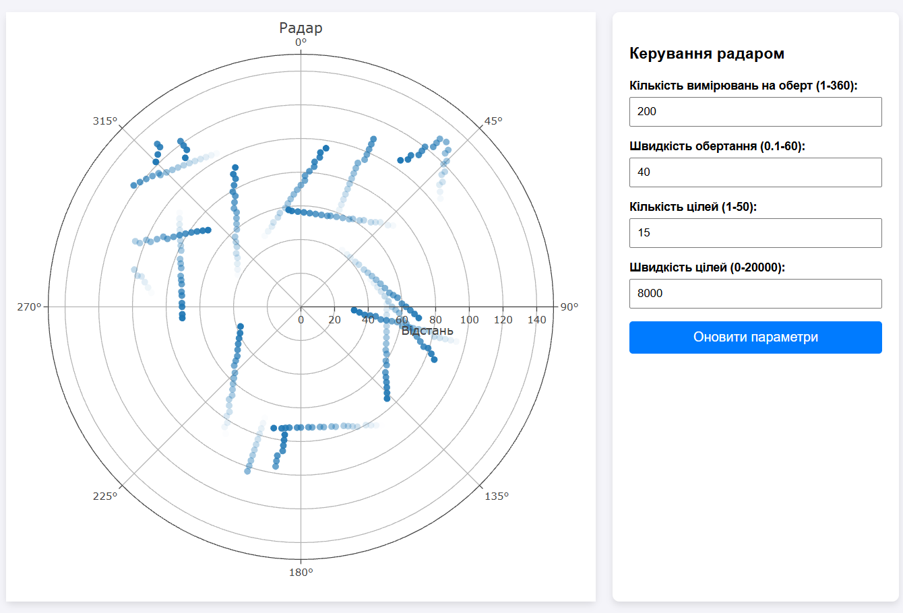

# Практична робота №2

## 1. Короткий опис роботи
Метою даної роботи було розробити веб-додаток, який зчитує дані з емулятора радару та відображає задетектовані цілі на графіку в полярних координатах. 

У рамках цього проекту було реалізовано:
*   Підключення до сервісу радара через WebSocket.
*   Обчислення відстані до цілей використовуючи час поширення імпульсу.
*   Побудова полярного графіка за допомогою бібліотеки Plotly з напрямком кутової осі за годинниковою стрілкою.
*   Ефект згасання цілей у часі (прозорість точок зменшується, формуючи "слід" цілі на екрані).
*   Керування параметрами радара (швидкість обертання, кількість цілей тощо) через АРІ запити (HTTP PUT) безпосередньо з інтерфейсу додатку.

## 2. Інструкції для запуску
Для запуску проекту необхідно виконати два кроки:

**Крок 1: Запуск емулятора радара через Docker**
Виконайте в терміналі команду для запуску образу:
```bash
docker run --rm --name radar-emulator -p 21700:21700 iperekrestov/university:radar-emulation-service-2026
```

**Крок 2: Запуск веб-додатку**
Відкрийте файл index.html у будь-якому веб-браузері. Ніяких додаткових серверів для фронтенду підіймати не потрібно, адже всі скрипти виконуються на стороні клієнта.

## 3. Результат роботи




## 4. Висновки
Під час виконання даної лабораторно-практичної роботи я навчився працювати з WebSocket для отримання даних у режимі реального часу. Також, я здобув практичні навички роботи з бібліотекою Plotly для побудови полярних графіків.